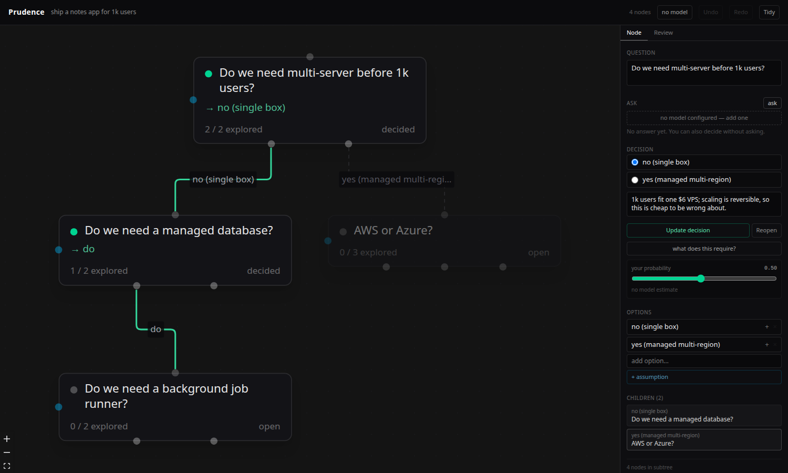
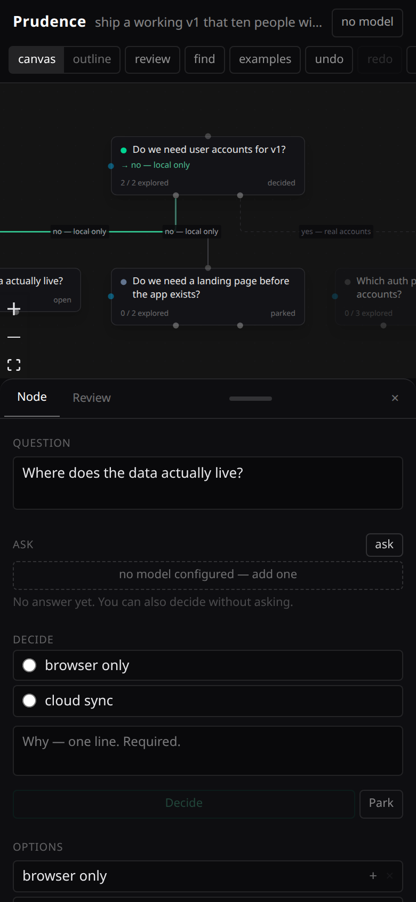

# Prudence

A decision canvas for building things. You are the director; the AI is a worker you summon per
question. It never decides, never structures your project, and never runs when you're not looking.

**Try it: https://codeafridi.github.io/Prudence/** — no account, no key needed to use the canvas.




Most AI planning tools generate a plan for you. Prudence interrogates the one you're already
holding: ask a question, get a yes/no/conditional with the consequence of each option, then make
the call yourself and write down why.

## Why

- **Short by force.** Verdicts are capped at 25 words, consequences at 20. Judgment is short;
  essays are why people stop reading advice.
- **You keep the pen.** `choice` and `rationale` are the only fields the AI cannot write. Asking
  is optional; deciding is the product.
- **The win is the question you didn't ask.** Decide before expanding — the log tracks *closure
  rate*, not node count or tokens.
- **Advice you can argue with.** Every option comes with `p` (probability it works out) and impact
  if it works or fails. You can override `p`. The export records both numbers.
- **A scoreboard for your judgement.** Record what happened and the Review panel scores the
  forecasts: what you said, what happened, and a Brier number against a coin flip.
- **Your keys, your browser.** Local-first: IndexedDB for projects, `localStorage` for API keys.
  No account, no server, no telemetry.

## Quick start

```sh
npm install
npm run dev          # http://localhost:5173
```

It works with **no API key**: build the tree, decide, review, export. On first run you get three
half-decided starter trees — including a parked branch and one you didn't take — so the shape is
visible before you type anything. Add a model when you want advice.

### Adding a model

Any OpenAI-compatible endpoint: OpenRouter, OpenAI, Groq, vLLM, Ollama, LM Studio.

Click the model button in the header → base URL, model id, key. For a local model:

```
base URL  http://localhost:11434/v1
model     llama3.1
key       ollama            (anything — it isn't checked)
```

The key stays in this browser. It is never written into a project, exported, or sent anywhere
except the endpoint you configured.

## Security and privacy

**What leaves this machine:** one HTTPS request to the endpoint you configure, when you press Ask,
Grill, Expand or Premortem. Nothing else — no analytics, no error reporting, no fonts or scripts
from a CDN, no server of ours. The browser test fails the build if any request goes off-origin on
load.

**What stays local:** the project (IndexedDB), the API key (`localStorage`), the goal and every
rationale. Share links put the tree in the URL *fragment*, which browsers never send to a server.

Stated plainly, because "secure" is not a checkbox:

- `localStorage` is **not encrypted**. Any script running on this origin, or anyone with access to
  your browser profile, can read the key. Use a scoped key with a spend limit, and revoke it when
  you're done.
- The production build ships a Content-Security-Policy with `script-src 'self'`, so an injected
  third-party script cannot run and exfiltrate the key. `connect-src` stays open because the model
  endpoint is whatever you configure; that is the one place the policy must trust you.
- A share link contains the whole tree, unencrypted. Anyone holding the link can read it. Keys are
  never part of a project, so they cannot be part of a link.
- Self-host the static bundle if you don't want to trust ours; serve the same CSP header at the
  host level if you can.

## How it works

```
goal ──► decision ──► option ──► requirement ──► decision ...
              │
              └──► assumption (a fact the model had to guess)
```

- **Ask** — verdict: one pick, one line why, per-option consequence + probability, and the single
  fact that would flip it. Assumptions come back as `unknowns[]`, one click from becoming a node.
- **Grill** — the strongest case against the pick.
- **Expand** — "what must be true for this choice to work?" Not brainstorming: requirements.
- **Decide** — pick an option and write one line. Required. No one-click accept, by design.
- **Premortem** — "it's a year later and this failed — why?" Three likeliest reasons, each one
  click from becoming a node.
- **Review** — schedule a retrospective (1/3/6 months) when you decide, then record what actually
  happened. The log becomes evidence instead of intention.
- **Park / Reopen** — park is "not now"; reopen archives the old choice into `history`.

Flags are computed, never stored: `premature` (parent undecided), `stale` (answered against a
different tree), `abandoned` (a branch you didn't take), `at risk` (backward induction says the
choice rests on unlikely assumptions).

Two ways to read the same tree: the canvas, and an **outline** list that survives trees larger than
one screen. On a phone the outline is the default, the inspector becomes a bottom sheet, and the
canvas keeps a minimum zoom so cards stay readable instead of shrinking to a thumbnail. `Cmd/Ctrl+K` jumps to any node by question or by the option you chose.

**Share** produces a link with the whole tree compressed into the URL hash — no server, no account,
and the hash is never sent over the network. The recipient gets the same log, uneditable history
intact, and can fork it into their own browser.

Export produces `DECISIONS.md`: the path you took, each fork, what you rejected, and where the
model's probability disagreed with yours. There is also a printable copy — one self-contained HTML
file with the same Form 1 layout, fonts inlined, no network and A4 page rules — so a record can be
handed to someone who does not have the app. The branch you did not take stays labelled.

## Status

Early, but the whole loop works: canvas, tree editing, undo, autosave, ask + verdicts, grill,
expand, premortem, decide/park/reopen, probability override, scheduled retrospectives,
deterministic review, markdown/JSON export, and a standalone printable record.
Not yet: mobile layout, real-time collaboration (that needs a server, which is a different product
decision).

Build in progress is documented in `AGENTS.md` (local) and the spec outside this repo.

## Develop

```sh
npm run dev         # vite
npm test            # node --test, no test runner dependency
npm run typecheck   # tsc --noEmit
npm run build       # typecheck + production bundle
```

### Browser test

```sh
npm run build
npm run preview -- --port 4173     # in another shell
npx playwright install chromium    # once
npm run e2e
```

Drives the real app: renders the canvas, decides a node, undoes and redoes, grows the tree,
exports the log, reloads to prove persistence, and fails on console errors or clipped nodes.
Set `CHROMIUM_PATH` to use a chromium you already have; `SHOT=/tmp/shot.png` for a screenshot.

Static output in `dist/` — deploy to any static host. No env vars, no server, no database.

GitHub Pages: push to `main` with `.github/workflows/pages.yml`, then enable
*Settings → Pages → Source: GitHub Actions* once. Asset paths are relative, so it also works from
a subpath, Netlify, Vercel or `python -m http.server dist`.

## Notes

What broke and why, when it did: https://codeafridi.github.io/blog/

## License

MIT
